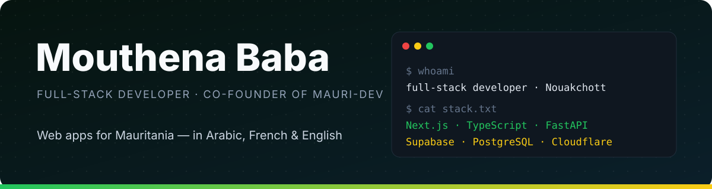

  

  
  
  

## About me

I'm a full-stack developer from Nouakchott, Mauritania, and a computer-science student at **SupNum** (Licence in Information Systems Development, class of 2028). I build web products for local users: bilingual Arabic/French interfaces, mobile-first layouts, and back ends that handle real national-scale data.

- 🏢 Member of **[Mauri-Dev](https://mauri-dev.online)**, a Nouakchott team that builds apps and websites for clients
- 💼 Full-stack intern at **Ibtikar Network** (summer 2026): Next.js and MongoDB on a mining-sector project
- 🌍 Working languages: Arabic, French, English

## Featured work

### 📊 Mth-Bac — baccalaureate results platform · [mth-bac.vercel.app](https://mth-bac.vercel.app)

Independent bilingual French/Arabic platform for Mauritanian baccalaureate results. **Designed and built by me, end to end.**

- Result lookup by candidate number across several sessions (BAC 2024, 2025 and 2026, regular and supplementary)
- Honour board of the national top 50, filterable by division, wilaya, institution and exam centre
- Admin import pipeline that validates the official Excel results file before anything is published
- Signed admin sessions and hashed passwords; public pages need no account
- PostgreSQL schema managed with Prisma, input validation with Zod, test suite with Vitest

`Next.js 16` `React 19` `TypeScript` `PostgreSQL` `Prisma` `Tailwind CSS` `Vitest` · [source code](https://github.com/mth-25053/Mth-Bac)

### 🎓 K.M — maths learning platform · [k-m.study](https://k-m.study)

Mobile-first platform for Mauritania's secondary-school maths programme: video lessons, a quiz after every lesson, chat with the teacher and an AI assistant for exercises. Built by a team of three; **I owned the student app**:

- the student-facing screens, from lessons to quizzes and past papers
- the shared design system (UI components)
- the data layer and internationalisation (`lib/data`, `lib/i18n`)

`Next.js` `TypeScript` `Supabase` `Cloudflare Workers` · private repository

### 🧩 With the Mauri-Dev team

Selected projects from our [portfolio](https://mauri-dev.online):

| Project | What it is | Live |
|---|---|---|
| **K.M** | Maths e-learning platform | [k-m.study](https://k-m.study) |
| **Skin Beauty** | Multilingual Korean-skincare store | [skin-beauty-nine.vercel.app](https://skin-beauty-nine.vercel.app) |

## Toolkit

  

## Get in touch

Open to internships, freelance work and collaboration on web products. The fastest way to reach me is [email](mailto:25053@supnum.mr) or [LinkedIn](https://www.linkedin.com/in/mouthena-baba-50593b396).
