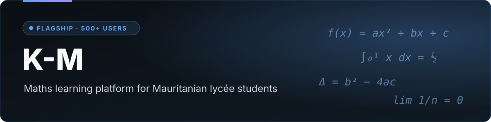
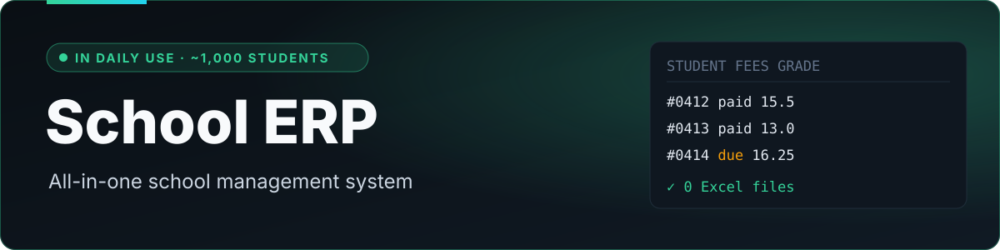
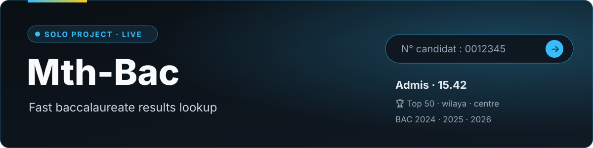
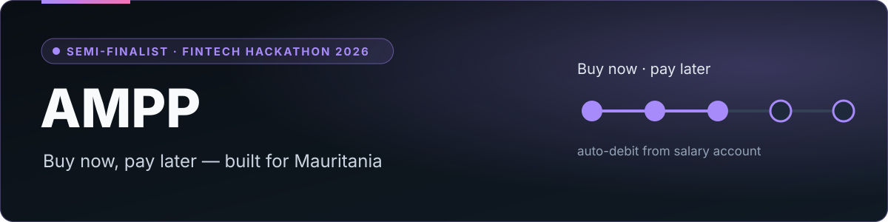
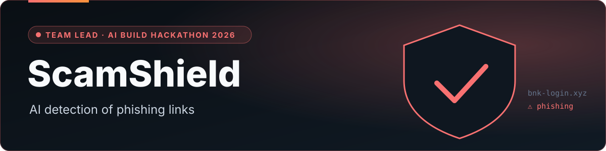
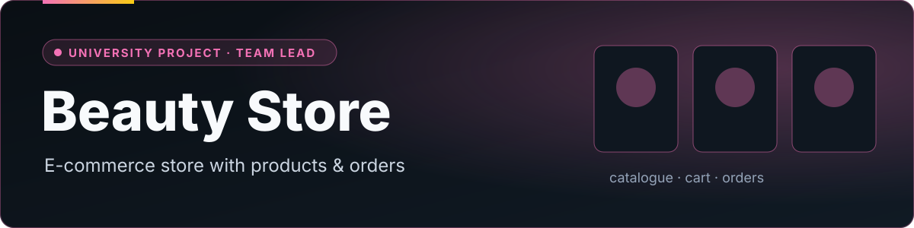

  

  
  
  

  
  
  
  

I build software that people in Mauritania use every day: a maths platform with 500+ learners, an ERP that runs a school of about 1,000 students, and a results site for the national baccalaureate. I'm a co-founder of **[Mauri-Dev](https://mauri-dev.online)** and a student at **SupNum** (Licence DSI, 2025 – 2028).

---

## 🚀 Projects

**Learning platform for Mauritanian lycée maths: video lessons, a quiz after every lesson, chat with the teacher, solved exam papers and an AI exercise assistant.**

- **Project lead.** I proposed the product, split the work across our team of three, and took on most of it
- Built the back end and much of the front end, and set up the infrastructure: Supabase, Cloudflare and video streaming with Bunny, on mobile and desktop
- In production with **500+ users**; I ship releases and keep the features evolving

`Next.js` `TypeScript` `Supabase` `Cloudflare Workers` `Bunny Stream` · 🌐 **[k-m.study](https://k-m.study)** · private repository

  

 

**All-in-one management system for a school, used every day by its staff and teachers.**

- Student enrolment, tuition fees and teacher payroll in one place
- Teachers enter their own grades in a simple interface: **no more Excel files** to collect and merge
- Deployed in a school of about **1,000 students**; I gather feedback from the administration and ship fixes and improvements

Web application · private (internal to the school)

 

**Independent French/Arabic platform for Mauritanian baccalaureate results. Designed and built by me, end to end.**

- Result lookup by candidate number for BAC 2024, 2025 and 2026 (regular and supplementary sessions)
- National top 50 honour board, filterable by division, wilaya, institution and exam centre
- Admin pipeline that validates the official Excel results file before anything is published; signed admin sessions

`Next.js 16` `React 19` `TypeScript` `PostgreSQL` `Prisma` `Zod` `Vitest` · 🌐 **[mth-bac.vercel.app](https://mth-bac.vercel.app)** · [source](https://github.com/mth-25053/Mth-Bac)

 

**Buy-now-pay-later service designed for Mauritania: instalments are deducted automatically from the buyer's salary account. Semi-finalist at the FinTech Hackathon Mauritania 2026.**

- **Technical lead.** I designed and built the full website and the interactive demo shown to the jury
- Turned the business model into a complete user journey, from choosing a product to the instalment plan

Hackathon prototype · web + interactive demo

 

**AI platform that detects phishing and malicious links aimed at Mauritanian users. Built at the Nouakchott AI Build Hackathon 2026.**

- **Team lead.** I led the team and the FastAPI back end that serves the detection

`Python` `FastAPI` `AI` · [repository](https://github.com/mth-25053/scamshield-mauritania)

 

**University team project: an e-commerce store with a product catalogue and order management. I was the project's official lead.**

`Python` `FastAPI` `MySQL`

---

## 💼 Experience

| Role | Where | When |
|---|---|---|
| **Co-founder** | [Mauri-Dev](https://mauri-dev.online) · software studio, Nouakchott | ongoing |
| **Full-stack developer intern** | Ibtikar Network · module of a platform for the mining sector (Next.js, MongoDB), code reviews and CI | Jul – Sep 2026 |

## 🧰 Toolkit

Only what I've shipped with:

  

## 📫 Get in touch

Looking for an internship where I can bring this to a professional team. Reach me by [email](mailto:25053@supnum.mr) or on [LinkedIn](https://www.linkedin.com/in/mouthena-baba-50593b396).
